# Catatan Keputusan Desain (Architecture Decision Record) & Analisis Streaming Pipeline

**Mata Kuliah**: Teknologi Big Data — Gasal 2026/2026  
**Topik**: Topic 11 — Mini Pipeline Ingestion (Kafka KRaft & PySpark Structured Streaming)  
**Kelompok**: Kelompok 6  

| Nama Anggota | NPM | Peran & Kontribusi Utama |
|---|---|---|
| **Muhammad Bryan Farras** | 2306230975 | Pengujian Beban & Laju (*Rate Testing* Bab 6.1), Analisis Batas Sistem (*Bottleneck Analysis*) |
| **Mirza Adi Raffiansyah** | 2306210323 | Desain Skema Payload JSON, Penentuan Partisi Topic Kafka & *Message Key Partitioning* |
| **Calvin Wirathama Katoroy** | 2306242395 | Konfigurasi Docker Kafka KRaft, PySpark Streaming Job (`stream_job.py`), Sink Konsol & Parquet |
| **Salim** | 2306204604 | Pengujian Pemulihan (*Recovery Testing* Bab 6.2), Penyusunan ADR 5 Bagian, & Diagram Arsitektur v0.3 |

**Studi Kasus**: Sistem Pemantauan dan Peringatan Dini Titik Api (*Hotspot*) Kebakaran Hutan & Lahan Indonesia (NASA FIRMS VIIRS)

---

## 1. Klasifikasi Aliran Data Proyek (Bab 2)

Sesuai prinsip perancangan arsitektur data terdistribusi, pemilihan paradigma pemrosesan (*Batch* vs. *Streaming*) harus didasarkan pada kebutuhan latensi bisnis, pengguna hasil analisis, dan konsekuensi biaya operasional, bukan semata karena ketertarikan teknologi. Jika suatu luaran data dapat mentoleransi keterlambatan 1 jam atau 24 jam tanpa merugikan keputusan operasional, pendekatan *Batch* jauh lebih hemat sumber daya dan stabil.

Berikut adalah klasifikasi aliran data proyek pemantauan kebakaran hutan dan lahan Kelompok 6:

| Aliran Data | Sumber Data | Latensi yang Dibutuhkan | Pilihan Paradigma | Alasan Bisnis & Konsekuensi Keterlambatan |
|---|---|---|:---:|---|
| **Aliran 1: Telemetri Deteksi Titik Api NRT (*Near Real-Time*)** | Satelit NASA FIRMS VIIRS (Suomi-NPP, NOAA-20, NOAA-21) via HTTP Stream / Webhook | **Detik hingga Menit (< 5 menit)** | **Streaming** (Kafka + Spark Structured Streaming) | **Kritis untuk Keselamatan**: Tim lapangan (Manggala Agni, BPBD, BNPB) membutuhkan peringatan dini kebakaran saat intensitas radiasi api (*Fire Radiative Power* - FRP $\ge 10\text{ MW}$) terdeteksi. Keterlambatan > 1 jam menyebabkan titik api merambat tak terkendali di lahan gambut (*peatland*), melipatgandakan biaya pemadaman udara (*water bombing*). |
| **Aliran 2: Aktivitas & Langganan Peringatan Pengguna (*Clickstream/Telemetry*)** | Aplikasi Web Pemantauan Titik Api & Portal SiPongi KLHK (Topic 11 Topic `klik`) | **Sub-detik hingga Detik** | **Streaming** (Kafka + Spark Structured Streaming) | **Responsivitas Operasional**: Memantau interaksi pengguna, navigasi sel grid wilayah rawan, dan lonjakan permintaan langganan peringatan SMS/WhatsApp secara *real-time*. Hasil agregasi 1 menit per kategori diperlukan untuk memantau beban server portal dan mengantisipasi lonjakan trafik darurat. |
| **Aliran 3: Vektor Kecepatan Angin & Kelembapan Udara (Cuaca)** | AWS BMKG & Open-Meteo API / Stasiun Meteorologi Darat | **15 Menit hingga 1 Jam** | **Micro-batch / Stream** (Spark Streaming / Micro-batch) | **Prediksi Perambatan Api Dinamis**: Model matematis perambatan api (*Rothermel Model*) memerlukan data arah dan kecepatan angin terbaru untuk memprediksi arah sebaran kabut asap (*smoke haze*) menuju pemukiman warga terdekat. |
| **Aliran 4: Peta Historis Area Terbakar (*Burn Scar*) & Morfologi Gambut** | Citra Satelit Sentinel-2 / Landsat-8 & Peta Kesatuan Hidrologis Gambut (KHG) KLHK | **24 Jam (Harian / Mingguan)** | **Batch** (Apache Hive, Pig, & Spark SQL di HDFS) | **Analisis Retrospektif & Regulasi**: Evaluasi kepatuhan konsesi perkebunan dan perencanaan rehabilitasi hidrologi sekat kanal gambut dihitung secara agregat harian/bulanan. Tidak ada keputusan operasional lapangan *real-time* yang terhambat jika laporan ini selesai dalam rentang waktu malam hari. |

---

## 2. Catatan Keputusan Desain (ADR) — 5 Bagian (Bab 7.1 & 7.2)

Halaman ini mendokumentasikan keputusan arsitektur lapisan *ingestion* dan *stream processing* yang menyambungkan sistem operasional HBase (Topic 9) dan sistem pemrosesan analitik Hive/Spark SQL (Topic 10).

### 2.1 Keputusan (Decisions Made)
1. **Adopsi Apache Kafka 4.3.1 (KRaft Mode)**: Menggunakan Apache Kafka dalam kontainer Docker (`apache/kafka:4.3.1`) tanpa ZooKeeper (*KRaft consensus*) pada port `9092` sebagai *event ingestion backbone* terdistribusi untuk menampung telemetri titik api dan *clickstream* pemantauan.
2. **Topik `klik` dengan 3 Partisi**: Membentuk topik `klik` dengan **3 partisi** dan faktor replikasi 1 (pada *single-node development*), yang dialokasikan selaras dengan kapasitas paralelisasi CPU lokal (3 thread eksekutor Spark).
3. **Skema Partisi Kunci (*Key Affinity*)**: Menetapkan kunci pesan (*message key*) berbasis representasi string UTF-8 dari `user_id` (atau `grid_id` pada konteks titik api). Pemetaan dilakukan melalui algoritma hashing deterministik bawaan Kafka (*MurmurHash2*), menjamin keteraturan urutan waktu pesan (*strict FIFO ordering*) per entitas pengguna/sel grid.
4. **PySpark 4.2.0 Structured Streaming Engine**: Menggunakan PySpark Structured Streaming dengan:
   - Deserialisasi payload JSON biner ke skema bertipe (`user_id`, `kategori`, `waktu`).
   - Batas toleransi data terlambat (*Event-time Watermark*) sebesar **2 menit** pada atribut stempel waktu data mentah (`waktu`).
   - Agregasi *tumbling window* sepanjang **1 menit** yang dikelompokkan berdasarkan kategori.
   - Dual-Sink Architecture: Sink `console` (mode `update`) untuk inspeksi *monitoring* langsung dan Sink `parquet` (mode `append`) ke `hasil/klik_per_menit` dengan *checkpointing* aktif di `chk/klik`.
5. **Kebijakan Durabilitas & Retensi**: Mengatur retensi pesan Kafka selama **168 jam (7 hari)** untuk memungkinkan pembacaan ulang (*replayability*) oleh *consumer* hilir (misalnya kalibrasi model deteksi asap atau *backfilling* ke Data Lake HDFS).

### 2.2 Konteks (Context, Requirements & Constraints)
- **Persyaratan Kasus Kebakaran Hutan**: Pada puncak musim kemarau (dataset Topic 9 merekam 1.999 titik api per hari di 239 sel grid aktif), ribuan sensor deteksi dan interaksi pengguna sistem tanggap darurat membanjiri sistem secara bersamaan. Keterlambatan deteksi bahaya berisiko fatal terhadap pemadaman dini kebakaran lahan gambut.
- **Keterbatasan Single-Node**: Klaster pengujian dijalankan pada satu mesin fisik Windows 11 / WSL2 Ubuntu 22.04 (prosesor Intel Core Ultra 7 155H, 22 vCPU, RAM 7,5 GiB). Sumber daya memori JVM dan overhead *context switching* membatasi penggunaan *broker cluster* multi-node yang berlebihan.
- **Kesinambungan Antar-Topik**:
  - *Topic 9*: Apache HBase 2.6.7 menyediakan *low-latency point lookup* (0,073 s) dan *narrow range scan* per sel grid (0,967 s untuk 925 baris) untuk antarmuka peta operasional.
  - *Topic 10*: Apache Hive 4.2.1 dan Spark SQL 4.2.0 mengolah data Parquet berpartisi `acq_date` (10.000 hingga 100.000 baris) untuk *join* batas provinsi dan laporan agregat harian.
  - *Topic 11*: Menjadi jembatan ingestion dan *stream analytics* yang menyaring anomali secara kontinu sebelum data dialirkan ke HBase maupun Parquet Data Lake.

### 2.3 Alternatif Ditolak (Rejected Alternatives & Detailed Rationale)
1. **RabbitMQ / Apache Pulsar**:
   - *Alasan Penolakan RabbitMQ*: RabbitMQ mengimplementasikan pola *smart broker / dumb consumer* dengan antrean AMQP klasik, di mana pesan dihapus segera setelah di-ACK oleh consumer. Pola ini tidak memiliki sifat *persistent immutable append-only commit log*. Pada skenario Topic 11, kemampuan *offset rewind*, pemutaran ulang (*replayability*), dan pemulihan *checkpoint* multi-consumer independen (misalnya Spark Streaming bersamaan dengan audit logger) tidak dapat dipenuhi oleh RabbitMQ.
   - *Alasan Penolakan Apache Pulsar*: Walaupun Pulsar memisahkan *compute* dan *storage* (Apache BookKeeper), arsitekturnya memerlukan minimal 3 komponen terpisah (*Broker*, *Bookie*, *ZooKeeper/Metadata Store*), yang membebani alokasi RAM dan sangat tidak efisien untuk dijalankan pada lingkungan tugas laboratorium atau *edge deployment*.
2. **Apache Flink / Kafka Streams**:
   - *Alasan Penolakan Kafka Streams*: Kafka Streams hanya mendukung bahasa Java/Scala murni dan terikat erat pada Kafka sebagai sumber dan tujuan. Hal ini membatasi ekosistem analitik tim yang dibangun berbasis Python/PySpark, serta menolak integrasi langsung ke format Parquet dan HDFS/HBase.
   - *Alasan Penolakan Apache Flink*: Apache Flink menawarkan model *true continuous streaming* tingkat lanjut, namun membutuhkan klaster mandiri (*JobManager* dan *TaskManager*) serta kurva pembelajaran baru bagi tim. PySpark Structured Streaming dipilih karena tim telah menguasai Spark SQL pada Topic 10, memungkinkan unifikasi kode dan logika bisnis (*unified batch & stream processing*).
3. **Kafka Berbasis ZooKeeper (Legacy CP-Kafka)**:
   - *Alasan Penolakan*: Kontainer Kafka legacy berbasis ZooKeeper (seperti Confluent 7.5.0 yang sebelumnya menduduki port 9092) memerlukan dua proses JVM terpisah, rentan *split-brain*, dan menambah konsumsi memori ~1 GiB hanya untuk koordinasi metadata. KRaft (Kafka Raft Metadata Mode) pada Kafka 4.3.1 menghilangkan ketergantungan ZooKeeper, menyederhanakan siklus hidup kontainer, dan mempercepat *controller election* hingga skala milidetik.
4. **Random / Round-Robin Partition Keying**:
   - *Alasan Penolakan*: Jika pesan dikirim tanpa kunci (*null key*) atau acak, event dari satu pengguna atau satu sensor titik api yang sama akan tersebar ke Partisi 0, 1, dan 2. Karena urutan (*ordering guarantee*) Kafka hanya berlaku **per partisi**, pengacakan kunci menghancurkan semantik waktu peristiwa (*event chronology*). Hal ini menyebabkan event perubahan status titik api (*DETEKSI* $\to$ *VERIFIKASI* $\to$ *PADAM*) dapat diproses secara terbalik oleh consumer. Penetapan kunci `str(user_id)` atau `str(grid_id)` menjamin afinitas partisi dan urutan FIFO yang ketat.

### 2.4 Konsekuensi (Trade-offs & Operational Consequences)
1. **Latensi Penulisan Parquet (Append Mode Watermark Lag)**:
   - Mode `append` pada agregasi berjendela menolak menulis baris parsial demi mencegah mutasi berkas Parquet yang mahal (*immutability*).
   - Konsekuensinya, baris jendela $[T, T + 1\text{ menit})$ baru akan ditulis ke disk Parquet setelah stempel waktu event terdeteksi melewati batas akhir jendela ditambah durasi watermark:
     $$\text{Waktu Emisi} \ge T + 1\text{ menit} + 2\text{ menit} = T + 3\text{ menit}$$
   - Konsekuensi ini dimitigasi dengan menyediakan dua sink: sink `console` (mode `update`) untuk peringatan instan sub-detik, dan sink `parquet` untuk persistensi analitik jangka panjang.
2. **Beban I/O Checkpoint Metadata**:
   - Tiap micro-batch Structured Streaming melakukan penulisan berkas atomik ke folder `chk/klik/offsets`, `chk/klik/commits`, dan `chk/klik/state`. Pada laju frekuensi micro-batch yang sangat tinggi, ini menciptakan ratusan berkas kecil (*metadata churn*). Manajemen retensi dan pembersihan metadata (*compact batches*) harus diaktifkan untuk jangka panjang.
3. **Keterikatan Paralelisasi Consumer terhadap Jumlah Partisi**:
   - Jumlah partisi topik Kafka menentukan batas atas jumlah worker paralel di Spark. Dengan 3 partisi, maksimal 3 core eksekutor Spark yang dapat membaca secara simultan per micro-batch. Jika volume data naik 100x, jumlah partisi harus direpartisi (*repartitioning*) di Kafka.

### 2.5 Bukti Empiris (Empirical Proof from Benchmark & Recovery Tests)
Semua keputusan arsitektur di atas telah diuji dan divalidasi secara empiris pada Milestone 1, 2, dan 3:
- **Bukti 1 (Throughput Ingestion)**: Pengujian laju bertahap (`test_rate.py` Bab 6.1) membuktikan bahwa dengan 3 partisi dan PySpark 4.2.0, sistem mampu menyerap laju 100, 1.000, hingga 10.000 pesan/detik dengan *processedRowsPerSecond* mencapai rata-rata **9.853,2 baris/s** (kapasitas burst puncak **18.348 baris/s**) tanpa tertinggal (*Tertinggal? Tidak*).
- **Bukti 2 (Ketahanan Pemulihan & Zero Gaps)**: Pengujian pemulihan (`test_recovery.py` Bab 6.2) membuktikan bahwa terminasi paksa proses Spark (`SIGTERM`, exit code -15) tidak merusak metadata `chk/klik`. Sebanyak 300 pesan yang dikirim saat Spark mati berhasil ditampung Kafka tanpa ada pesan yang hilang, dan saat Spark dinyalakan kembali dari *checkpoint* yang sama, Spark melanjutkan proses dari offset commit terakhir, mengejar ketertinggalan dalam satu micro-batch pertama, dan menghasilkan **5 jendela Parquet berturutan dengan kontinuitas 100% tanpa ada celah waktu (Zero Gaps)**.

---

## 3. Jawaban Komprehensif 5 Pertanyaan Pemulihan Checkpoint (Bab 6.2)

Berdasarkan pengujian langsung skrip `test_recovery.py` pada lingkungan WSL2 Ubuntu 22.04 dan PySpark 4.2.0, berikut adalah penjelasan teknis konseptual dan empiris untuk 5 pertanyaan panduan tugas:

### Pertanyaan 1: Apa yang terjadi saat proses streaming dimatikan (crash)?
**Jawaban**:  
Ketika proses Spark Structured Streaming dihentikan paksa (baik melalui `Ctrl+C`, `SIGTERM`, `SIGKILL`, maupun kegagalan JVM):
1. **Sisi Spark**:
   - Thread pemroses micro-batch langsung terhenti. State store di memori (*in-memory state*) pada batch yang belum selesai akan hilang.
   - Namun, seluruh riwayat transaksi yang telah selesai (*committed batches*) telah ditulis secara atomik ke disk pada direktori `chk/klik/commits/<batch_id>` dan `chk/klik/offsets/<batch_id>`. File-file ini tidak mengalami korupsi berkat operasi atomic rename pada Write-Ahead Log (WAL).
2. **Sisi Kafka**:
   - Broker Kafka (`apache/kafka:4.3.1`) tidak terpengaruh oleh matinya consumer. Broker terus beroperasi secara independen menerima data dari producer.
   - Pesan-pesan baru yang masuk disimpan secara sekuensial ke dalam file *log segment* partisi disk (`/tmp/kafka-logs/klik-0/`, `klik-1/`, `klik-2/`).
   - Log End Offset (LEO) tiap partisi terus bertambah maju (pada pengujian kami bertambah tepat 300 pesan). Kafka berfungsi sebagai *persistent buffer* elastis yang menyerap lonjakan trafik tanpa ada data yang terbuang (*zero message drop*).

### Pertanyaan 2: Berapa lama waktu yang dibutuhkan Spark untuk mengejar ketertinggalan (catch-up latency)?
**Jawaban**:  
Waktu yang dibutuhkan Spark untuk menyerap antrean (*catch-up*) ditentukan oleh:
$$\text{Waktu Catch-Up} = \text{Startup Overhead} + \frac{\text{Jumlah Pesan Tertimbun}}{\text{Throughput Pemrosesan Batch}}$$
Berdasarkan log pengujian empiris `test_recovery.py`:
1. **Startup Overhead**: Inisialisasi JVM PySpark, koneksi ke Kafka broker, dan deserialisasi metadata checkpoint membutuhkan waktu $\sim 2.0 - 3.5$ detik.
2. **Pemrosesan Backlog**: Pada batch pemulihan pertama (Batch 2), Spark membaca seluruh selisih offset Kafka dari commit terakhir. Sebanyak 300 pesan backlog diserap dan diagregasikan dalam waktu **0,42 detik** (efektif >25.000 rows/s pada pembacaan batch dari buffer lokal disk Kafka).
3. **Total Latensi**: Seluruh ketertinggalan terserap tuntas dalam **1 micro-batch pertama** (total durasi $\approx 3$ detik sejak perintah dieksekusi). Pada volume produksi skala industri (misal akumulasi 1.000.000 pesan saat downtime 10 menit), Spark Structured Streaming dapat dibatasi lajunya menggunakan parameter `maxOffsetsPerTrigger = 50000` agar tidak memicu lonjakan memori (*OOM*), dan mengejar ketertinggalan secara bertahap dalam beberapa siklus micro-batch terukur.

### Pertanyaan 3: Mengapa jendela waktu selama downtime tetap terisi utuh dan tidak berlubang (zero gaps)?
**Jawaban**:  
Jendela waktu tetap utuh dan kontinu karena PySpark Structured Streaming mengadopsi semantik **Event-Time Processing**, bukan *Processing-Time*:
1. **Pemisahan Waktu Peristiwa vs. Waktu Proses**:
   - Waktu pengelompokan (*grouping window*) didasarkan pada kolom data mentah `waktu` yang tertanam dalam payload JSON (`datetime.now(timezone.utc)`), bukan jam dinding saat mesin Spark memproses pesan tersebut.
2. **State Store Restorasi**:
   - Saat Spark menyala kembali di Fase 4, Spark memulihkan *state store* dari `chk/klik/state/0/{0,1,2}/` yang mencatat jendela-jendela waktu yang masih terbuka sebelum crash.
   - Pesan-pesan menit ke-4 yang dikirim saat Spark mati memiliki stempel waktu `2026-11-12 10:21:00 - 10:22:00`. Begitu pesan ini dibaca dari backlog Kafka, Spark menempatkannya ke dalam bucket tumbling window `[10:21:00, 10:22:00)` yang sesuai.
3. **Flushing via Watermark**:
   - Ketika event pembilas (Fase 4, menit ke-5, 6, dan 7) masuk, nilai $\max(\text{waktu})$ maju menjadi $10:24:xx$.
   - Batas watermark ($\max(\text{waktu}) - 2\text{ menit}$) bergeser melewati $10:22:00$. Spark menyatakan jendela downtime telah final dan menuliskan 5 kategori (total 300 baris, 60 per kategori) ke berkas Parquet.
   - Hasil akhir pembacaan Parquet menunjukkan 5 jendela waktu berurutan tanpa ada satu detik pun rentang waktu yang bolong (*zero gaps*).

### Pertanyaan 4: Apa yang akan terjadi bila folder `chk/klik` dihapus?
**Jawaban**:  
Folder `chk/klik` menyimpan seluruh status operasional sistem:
1. `chk/klik/metadata`: ID unik query streaming.
2. `chk/klik/offsets/`: Log offset Kafka yang telah dialokasikan per batch.
3. `chk/klik/commits/`: Tanda bukti bahwa batch telah berhasil ditulis ke sink.
4. `chk/klik/state/`: Snapshot delta parsial dari agregasi *tumbling window* yang sedang berjalan.

Bila folder ini dihapus sebelum restart:
- **Kehilangan Rekam Jejak**: Spark memperlakukan job tersebut sebagai pipeline baru yang belum pernah dijalankan sebelumnya.
- **Risiko Duplikasi Data Ekstrem**: Jika skrip menggunakan konfigurasi bawaan `startingOffsets = "earliest"`, Spark akan membaca ulang topik `klik` dari Offset 0. Akibatnya, data menit ke-0 hingga ke-3 yang sebelumnya sudah pernah ditulis ke Parquet akan diproses ulang dan ditulis kembali ke Parquet, melipatgandakan hitungan agregasi (*massive duplication*).
- **Risiko Kehilangan Data**: Jika diubah ke `startingOffsets = "latest"`, seluruh pesan backlog 300 event yang terakumulasi di Kafka saat Spark mati akan langsung diabaikan (*data loss*).
- **Kesimpulan**: Integritas direktori checkpoint adalah syarat mutlak untuk menjamin semantik **Exactly-Once Stream Processing** dan ketahanan pemulihan bencana (*Disaster Recovery*).

### Pertanyaan 5: Mengapa parameter `startingOffsets` hanya berlaku saat job pertama kali dijalankan tanpa checkpoint?
**Jawaban**:  
Ini adalah kontrak desain fundamental dari Apache Spark Structured Streaming:
1. **Evaluasi Saat Inisialisasi Perdana**: Parameter `startingOffsets` (opsi `earliest` atau `latest`) dirancang hanya sebagai **titik awal (bootstrap)** untuk menentukan dari mana stream harus mulai membaca ketika belum ada rekam jejak sama sekali.
2. **Kedaulatan Log Checkpoint**:
   - Begitu query berhasil menjalankan Batch 0, posisi offset partisi Kafka yang dibaca dicatat ke dalam Write-Ahead Log (`chk/klik/offsets/0`).
   - Pada setiap restart berikutnya, driver Spark memprioritaskan membaca file commit terakhir (`chk/klik/commits/K`) dan file offset berikutnya.
   - Spark Structured Streaming secara eksplisit mengabaikan parameter `startingOffsets` yang tertulis pada kode aplikasi. Jika Spark menuruti `startingOffsets="earliest"` saat ada checkpoint, sistem akan mengalami *infinite replay loop*. Sebaliknya, jika Spark menuruti `latest`, data backlog di antara waktu crash dan restart akan terlewatkan.
   - Dengan mengabaikan `startingOffsets` setelah inisialisasi, Spark menjamin kontinuitas aliran data yang deterministik tanpa intervensi manual pengembang.

---

## 4. Diagram Arsitektur Terintegrasi v0.3 (Bab 7.3)

Diagram arsitektur sistem v0.3 memperbarui Diagram v0.2 dari Topic 10 dengan mengintegrasikan secara utuh seluruh lapisan: **Data Sources**, **Ingestion (Kafka KRaft)**, **Processing (Spark Structured Streaming & Spark SQL/Hive)**, **Storage (Parquet Data Lake, Checkpoint WAL, HBase)**, dan **Serving (Alerts, REST API, Dashboard Interaktif)**.

Garis biru tebal melambangkan **Aliran Streaming (Real-Time)**, sedangkan garis oranye putus-putus melambangkan **Aliran Batch**.

```mermaid
flowchart LR
    %% Data Sources
    subgraph S1 ["1. DATA SOURCES"]
        SRC_VIIRS["NASA FIRMS VIIRS<br/>(Real-time Hotspot Stream)"]
        SRC_CLICK["Web App Telemetri<br/>(Clickstream JSON)"]
        SRC_BATCH["Data Historis & BMKG<br/>(239 Grid Provinsi CSV)"]
    end

    %% Ingestion Layer (Topic 11)
    subgraph S2 ["2. INGESTION LAYER (Topic 11)"]
        PROD["Python Producer<br/>(producer.py / Pacing Laju)"]
        KAFKA["Kafka Broker 4.3.1 (KRaft)<br/>Port 9092 - ZooKeeper Free"]
        subgraph TOPIC_KLIK ["Topic: klik (3 Partisi)"]
            P0["Partisi 0 (Offset Log)"]
            P1["Partisi 1 (Offset Log)"]
            P2["Partisi 2 (Offset Log)"]
        end
    end

    %% Processing Layer (Topic 10 & 11)
    subgraph S3 ["3. PROCESSING LAYER"]
        subgraph SPARK_STREAM ["Spark Structured Streaming (PySpark 4.2.0)"]
            PARSE["JSON Deserializer &amp; Timestamp"]
            WATERMARK["Watermark: 2 Menit"]
            WINDOW["Tumbling Window: 1 Menit"]
            STATE["In-Memory State Store"]
        end
        subgraph BATCH_PROC ["Batch Processing (Topic 10)"]
            SPARK_SQL["Spark SQL 4.2.0 (Catalyst Engine)"]
            HIVE["Apache Hive 4.2.1 (Tez &amp; Metastore)"]
        end
    end

    %% Storage Layer (Topic 9, 10, 11)
    subgraph S4 ["4. STORAGE LAYER"]
        SINK_PQ["Parquet Data Lake<br/>(hasil/klik_per_menit/)"]
        CHK["Checkpoint WAL<br/>(chk/klik/)"]
        HBASE["Apache HBase 2.6.7<br/>Tabel: hotspot (Topic 9)"]
        PQ_PART["Parquet Warehouse<br/>hotspot_part (Topic 10)"]
    end

    %% Serving & Application Layer (Topic 12)
    subgraph S5 ["5. SERVING & APPLICATION"]
        ALERT["Early Warning Engine<br/>(FRP &gt;= 10 MW Alerts)"]
        API["FastAPI GIS Backend<br/>(GeoJSON &amp; Query Sel)"]
        UI["Dashboard Interaktif<br/>(Streamlit / Superset)"]
    end

    %% Streaming Connections (Solid Blue)
    SRC_VIIRS ==>|Stream Ingest| PROD
    SRC_CLICK ==>|Event Stream| PROD
    PROD ==>|Key: str user_id| KAFKA
    KAFKA --- P0 & P1 & P2
    P0 & P1 & P2 ==>|Sub-detik Consumer| PARSE
    PARSE --> WATERMARK --> WINDOW --> STATE
    STATE ==>|Append Mode Finalized| SINK_PQ
    STATE -.->|State Commit &amp; Offset WAL| CHK
    CHK -.->|Recovery State on Restart| STATE
    WINDOW ==>|Live Update Mode| ALERT

    %% Batch Connections (Dashed Orange)
    SRC_BATCH -.->|Batch Load| SPARK_SQL
    SRC_BATCH -.->|Batch Load| HIVE
    SPARK_SQL -.->|Broadcast Join 239 Grid| PQ_PART
    HIVE -.->|Metastore DDL| PQ_PART
    SRC_VIIRS -.->|Daily Export| HBASE

    %% Serving Connections
    ALERT ==>|Push Notif BPBD| UI
    HBASE ==>|Point Lookup 0.073s| API
    SINK_PQ ==>|Aggregated Windows| API
    PQ_PART -.->|Historical Trends| UI
    API ==>|REST / GeoJSON| UI

    %% Styling
    classDef stream fill:#0284c7,stroke:#bae6fd,stroke-width:2px,color:#ffffff;
    classDef batch fill:#b45309,stroke:#fde68a,stroke-width:2px,color:#ffffff;
    classDef storage fill:#064e3b,stroke:#a7f3d0,stroke-width:2px,color:#ffffff;
    classDef serving fill:#701a75,stroke:#f5d0fe,stroke-width:2px,color:#ffffff;

    class SRC_VIIRS,SRC_CLICK,PROD,KAFKA,P0,P1,P2,PARSE,WATERMARK,WINDOW,STATE,ALERT stream;
    class SRC_BATCH,SPARK_SQL,HIVE,PQ_PART batch;
    class SINK_PQ,CHK,HBASE storage;
    class API,UI serving;
```

> **Berkas Visual Beresolusi Tinggi**:
> - Vektor SVG: [`report/diagram_v03.svg`](report/diagram_v03.svg)
> - Gambar PNG: [`report/diagram_v03.png`](report/diagram_v03.png)

---

## 5. Ringkasan Eksekutif & Kesiapan Menuju Topic 12

Penyelesaian Topic 11 menandai keberhasilan pembuktian jalur pipa data (*pipeline*) hulu-ke-hilir:
1. **Ketahanan Ingestion**: Apache Kafka KRaft mampu menampung lonjakan trafik hingga 10.000 event/detik dan bertindak sebagai penyangga saat subsistem pemroses mengalami pemadaman tidak terduga.
2. **Determinisme Pemrosesan**: PySpark Structured Streaming berhasil melakukan agregasi berbasis waktu peristiwa (*event-time*) dengan akurasi 100% dan memulihkan diri dari *checkpoint* tanpa ada data yang terduplikasi maupun terlewat (*zero gaps, zero loss*).
3. **Fondasi Topic 12**: Data teragregasi pada Parquet (`hasil/klik_per_menit`) dan penyimpanan operasional HBase siap dikonsumsi langsung oleh lapisan penyajian (*Serving Layer*) Topic 12 untuk membangun antarmuka dasbor visualisasi geospasial interaktif dan sistem peringatan darurat kabut asap bagi pemerintah dan masyarakat.
