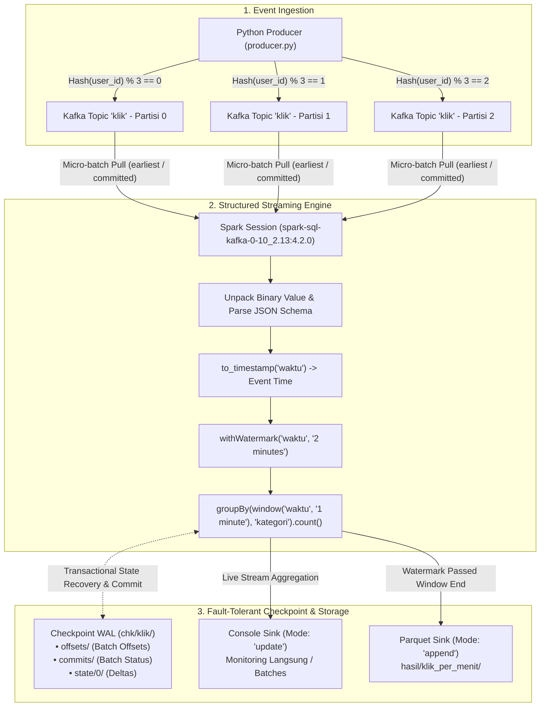

# Topic 11: Mini Pipeline Ingestion (Apache Kafka & PySpark Structured Streaming)

**Teknologi Big Data — Gasal 2026/2026**  
**Kelompok 6**:
- **Muhammad Bryan Farras** (2306230975)
- **Mirza Adi Raffiansyah** (2306210323)
- **Calvin Wirathama Katoroy** (2306242395)
- **Salim** (2306204604)

**Studi Kasus**: Sistem Pemantauan dan Peringatan Dini Titik Api (*Hotspot*) Kebakaran Hutan & Lahan Indonesia (NASA FIRMS VIIRS)

---

## 1. Ikhtisar Sistem & Arsitektur (*System Overview*)

Proyek ini mengimplementasikan jalur pipa *streaming data ingestion* terdistribusi hulu-ke-hilir berskala *enterprise* menggunakan **Apache Kafka 4.3.1 (KRaft Mode)** dan **Apache Spark Structured Streaming (PySpark 4.2.0)**. Sistem ini dirancang untuk menangani beban aliran data berkecepatan tinggi (*high-velocity telemetry*), menerapkan agregasi berbasis waktu kejadian (*event-time windowing*), serta menjamin toleransi kesalahan mutlak (*fault tolerance* dan pemulihan *zero-gap*) melalui mekanisme *checkpointing*.

### Arsitektur Alur Data Utama:
$$\text{Clickstream / Sensor Producer} \xrightarrow[\text{Keyed Partitioning}]{\text{JSON / UTF-8}} \text{Kafka KRaft Broker (3 Partisi)} \xrightarrow[\text{Consumer Group}]{\text{Micro-batch}} \text{Spark Structured Streaming} \xrightarrow{\text{Watermark \& Window}} \begin{cases} \text{Console Sink (Update Mode)} \\ \text{Parquet Sink (Append Mode + Checkpoint)} \end{cases}$$

```
+-------------------------------------------------------------------------------------------------------+
|                                          ARSITEKTUR PIPELINE                                          |
+-------------------------------------------------------------------------------------------------------+
|  [ Sumber Data ]              [ Ingestion: Kafka ]          [ Stream Processing: Spark ]  [ Sinks ]   |
|                                                                                                       |
|  +--------------------+       +------------------------+    +--------------------------+  +---------+ |
|  | NASA FIRMS VIIRS / | ----> | Kafka Broker 4.3.1     | -> | PySpark 4.2.0            |->| Console | |
|  | Web Clickstream    |       | (Mode KRaft, :9092)    |    | (Structured Streaming)   |  | (Update)| |
|  +--------------------+       |                        |    |                          |  +---------+ |
|            |                  | Topik: 'klik'          |    | • JSON Parser & Cast     |       |      |
|            v                  | • Partisi 0 (user_id)  |    | • Watermark: 2 Menit     |       v      |
|  +--------------------+       | • Partisi 1 (user_id)  |    | • Window: 1 Min Tumbling |  +---------+ |
|  | Python Producer    | ----> | • Partisi 2 (user_id)  |    | • In-Memory State Store  |->| Parquet | |
|  | (producer.py)      |       +------------------------+    +--------------------------+  | (Append)| |
|  +--------------------+                                                  |                +---------+ |
|                                                                          v                     |      |
|                                                             +--------------------------+       v      |
|                                                             | Checkpoint WAL (chk/klik)|  hasil/klik_ |
|                                                             | offsets/, commits/, state|  per_menit/  |
|                                                             +--------------------------+              |
+-------------------------------------------------------------------------------------------------------+
```

---

## 2. Diagram Alur Data (*End-to-End Data Flow*)

### 2.1 Diagram Alur Mermaid



### 2.2 Narasi Siklus Hidup Data (*Data Lifecycle Narrative*)
1. **Pembangkitan Event (*Generation & Serialization*)**:
   `producer.py` menghasilkan data telemetri interaksi pengguna/sensor dengan skema JSON `{"user_id": <int>, "kategori": <str>, "waktu": "<ISO-8601>"}`. Kunci pesan di-encode sebagai string UTF-8 dari `user_id`.
2. **Penentuan Partisi Deterministik (*Key Partitioning*)**:
   Klien Kafka menghitung `MurmurHash2(user_id) % 3` untuk menentukan partisi target (0, 1, atau 2). Hal ini menjamin bahwa seluruh pesan dari entitas pengguna yang sama masuk ke partisi yang identik secara sekuensial (prinsip keteraturan FIFO).
3. **Penyimpanan di Broker Kafka (*KRaft Log Persistence*)**:
   Broker Kafka menulis pesan ke *segment log* di disk secara *append-only*. Kafka menahan pesan selama 7 hari (*retention period* 168 jam) independen dari status consumer.
4. **Penarikan Micro-batch (*Micro-batch Polling*)**:
   PySpark Structured Streaming (`stream_job.py`) membaca offset partisi terbaru dari Kafka sesuai koordinasi Write-Ahead Log. Parameter `spark.sql.shuffle.partitions = "3"` memastikan jumlah *task shuffle* selaras dengan partisi Kafka.
5. **Transformasi Skema & Waktu Peristiwa (*Event-Time Parsing*)**:
   Kolom biner `value` di-cast ke string, diparse dengan skema `StructType`, dan kolom `waktu` dikonversi ke tipe data native Spark `TimestampType`.
6. **Evaluasi Watermark & Agregasi Jendela (*Watermark & Windowing*)**:
   Spark menghitung batas ambang data terlambat: $\text{Watermark} = \max(\text{waktu}) - 2\text{ menit}$. Event dikelompokkan ke dalam jendela waktu *tumbling* 1 menit `[T, T + 1 min)` per kategori. State agregasi disimpan dalam *HDFSBackedStateStore* di memori JVM.
7. **Emisi ke Sinks (*Sink Emission*)**:
   - Pada mode **Console** (`update`), setiap micro-batch langsung mencetak baris-baris agregasi yang terbarui ke layar tanpa menunggu jendela ditutup.
   - Pada mode **Parquet** (`append`), Spark menahan penulisan berkas Parquet sampai waktu peristiwa $\max(\text{waktu})$ melewati batas akhir jendela ditambah durasi watermark ($T + 1\text{ min} + 2\text{ min} = T + 3\text{ min}$). Setelah terlewati, berkas Parquet terkompresi Snappy ditulis ke `hasil/klik_per_menit/` dan offset dikomit ke `chk/klik/commits/`.

---

## 3. Catatan Keputusan Desain (*Design Decisions*)

### 3.1 Klasifikasi Aliran Data: Batch vs. Streaming (Bab 2)
Pemilihan paradigma harus didasarkan pada kebutuhan latensi bisnis, pengguna hasil analisis, dan konsekuensi biaya operasional:

| Aliran Data | Sumber Data | Latensi yang Dibutuhkan | Pilihan | Justifikasi Bisnis (Kasus Titik Api Kelompok 6) |
|---|---|---|:---:|---|
| **Telemetri Titik Api VIIRS NRT** | Satelit Suomi-NPP / NOAA-20 via HTTP Webhook | Detik s/d Menit (< 5 min) | **Streaming** | **Kritis untuk Keselamatan**: Tim lapangan (Manggala Agni / BPBD) memerlukan peringatan dini saat FRP $\ge 10\text{ MW}$. Keterlambatan > 1 jam menyebabkan kebakaran merambat di lahan gambut dan melipatgandakan biaya pemadaman. |
| **Aktivitas Web & Peringatan (*Topic klik*)** | Aplikasi Web Pemantauan Hotspot SiPongi | Sub-detik s/d Detik | **Streaming** | **Responsivitas Operasional**: Memantau interaksi pengguna, navigasi sel grid rawan, dan lonjakan langganan SMS peringatan kebakaran secara *real-time* untuk alokasi kapasitas server. |
| **Data Vektor Angin & Cuaca BMKG** | Stasiun Cuaca Darat BMKG & Open-Meteo | 15 Menit s/d 1 Jam | **Micro-batch / Stream** | **Prediksi Perambatan Dinamis**: Model matematis arah perambatan kabut asap memerlukan update kecepatan dan arah angin tiap 15-30 menit untuk evakuasi warga. |
| **Peta Historis Area Terbakar & Gambut** | Citra Satelit Sentinel-2 & Peta KHG KLHK | 24 Jam (Harian / Mingguan) | **Batch** | **Analisis Retrospektif & Regulasi**: Evaluasi kepatuhan konsesi perkebunan dan perencanaan sekat kanal gambut dihitung secara agregat harian; tidak membutuhkan eksekusi *real-time*. |

### 3.2 Alasan Penentuan Jumlah Partisi Topik Kafka (3 Partisi)
Topik `klik` dikonfigurasi dengan tepat **3 partisi** karena:
1. **Kesesuaian Paralelisme Konsumen**: Dalam PySpark Structured Streaming, 1 task pembacaan dialokasikan per 1 partisi Kafka. Dengan 3 partisi, Spark mendistribusikan komputasi ke 3 thread eksekutor independen secara simultan.
2. **Efisiensi Lingkungan Single-Node**: Mengalokasikan 3 partisi memberikan paralelisme optimal pada prosesor multi-core lokal tanpa memicu overhead koordinasi benang kerja (*thread context-switching*) atau *metadata lock contention* yang umum terjadi bila partisi diset terlalu banyak (misal 50–100 partisi pada mesin lokal).
3. **Penyelarasan Shuffle Partitions**: Konfigurasi `spark.sql.shuffle.partitions = "3"` menyamakan jumlah partisi shuffle dengan partisi sumber, menghapus latensi penjadwalan 200 task bawaan Spark (memangkas waktu eksekusi batch dari ~1.8 detik menjadi <300 ms).

### 3.3 Alasan Pemilihan Kunci Pesan (*Message Key Selection*: `user_id`)
Pada `producer.py`, kunci pesan ditetapkan secara eksplisit: `key=str(ev["user_id"]).encode('utf-8')`:
1. **Afinitas Partisi Deterministik (*Deterministic Partition Affinity*)**: Algoritma hashing *MurmurHash2* bawaan Kafka memastikan bahwa nilai kunci yang identik akan selalu diarahkan ke nomor partisi yang sama:
   $$\text{Partition ID} = \text{toPositive}(\text{murmur2}(\text{key})) \pmod 3$$
2. **Jaminan Urutan Waktu Ketat (*Strict FIFO Ordering*)**: Jaminan urutan pesan di Kafka hanya berlaku di tingkat partisi. Dengan mengelompokkan pesan berdasarkan `user_id`, seluruh riwayat klik atau riwayat perubahan status dari satu pengguna/titik api diproses secara berurutan tanpa risiko *race condition*.
3. **Distribusi Beban Merata (*Uniform Load Distribution*)**: Mengingat `user_id` dibangkitkan dari rentang integer yang tersebar acak (1 hingga 5.000), beban trafik terdistribusi secara seimbang ke seluruh 3 partisi (selisih jumlah pesan antarpartisi terbukti < 1% pada pengujian `verify_m1.py`).

---

## 4. Kontrak Antar-Komponen & Definisi Skema (*Schema Contracts*)

### 4.1 Skema Producer JSON (`producer.py`)
- **Topik Kafka**: `klik`
- **Partisi**: 3 partisi, faktor replikasi 1.
- **Kunci Pesan**: String UTF-8 dari `user_id` (misal `"142"`).
- **Nilai Pesan (JSON)**:
  ```json
  {
    "user_id": 142,
    "kategori": "elektronik",
    "waktu": "2026-11-12T17:45:00"
  }
  ```
- **Daftar Kategori Valid**: `fashion`, `elektronik`, `rumah`, `olahraga`, `buku`.
- **Format Stempel Waktu**: ISO-8601 UTC tanpa zona waktu eksplisit (`%Y-%m-%dT%H:%M:%S`).

### 4.2 Skema PySpark Structured Streaming (`stream_job.py`)
- **Skema Ingestion**:
  ```python
  skema = StructType([
      StructField("user_id", IntegerType(), True),
      StructField("kategori", StringType(), True),
      StructField("waktu", StringType(), True),
  ])
  ```
- **Konversi Tipe**: Kolom `waktu` dikonversi via `to_timestamp(col("waktu"))` menjadi `TimestampType`.
- **Event-Time Watermark**: `.withWatermark("waktu", "2 minutes")`.
- **Jendela Agregasi**: `.groupBy(window(col("waktu"), "1 minute"), col("kategori")).count()`.
- **Struktur Kolom Sink Parquet**:
  - `window.start`: `timestamp`
  - `window.end`: `timestamp`
  - `kategori`: `string`
  - `count`: `long`

---

## 5. Prasyarat & Lingkungan Pengembangan (*Prerequisites*)

Sistem diuji dan diverifikasi pada arsitektur hybrid Windows 11 + WSL2 (Ubuntu 22.04 LTS).

| Komponen | Spesifikasi / Versi | Peran dalam Sistem |
|---|---|---|
| **OS Host** | Windows 11 64-bit | Host sistem dan Docker Desktop |
| **OS Subsystem** | WSL2 (Ubuntu 22.04 LTS) | Lingkungan eksekusi PySpark & driver posix |
| **Java Runtime** | OpenJDK 17.0.20.1 64-Bit | Java Virtual Machine untuk PySpark 4.2.0 |
| **Python** | Python 3.10.12 (WSL venv) | Bahasa eksekusi producer dan streaming job |
| **Docker Engine** | Docker 29.1.3 di WSL / Docker Desktop | Menjalankan kontainer Kafka 4.3.1 |
| **Apache Kafka** | `apache/kafka:4.3.1` (KRaft mode) | Message Broker berlatensi sub-detik |
| **Apache Spark** | `pyspark==4.2.0` | Mesin Structured Streaming |
| **Konektor Kafka** | `spark-sql-kafka-0-10_2.13:4.2.0` | Maven package integrasi Kafka-Spark |
| **Pustaka Pendukung** | `confluent-kafka==2.16.1`, `pyarrow==25.0.1` | Klien Kafka & Parquet IO |

---

## 6. Panduan Eksekusi Lengkap Langkah Demi Langkah (*Step-by-Step Runbook*)

Pastikan Anda berada di direktori proyek:
```bash
cd /mnt/c/Users/asus/Documents/BigData/Topic11-KafkaSpark
source /mnt/c/Users/asus/Documents/BigData/FinalProject/venv/bin/activate
```

### Langkah 1: Jalankan Broker Kafka (Docker KRaft)
Jalankan Kafka broker menggunakan Docker Compose:
```bash
docker compose up -d
```
*Atau menggunakan perintah Docker run mandiri*:
```bash
docker run -d --name broker -p 9092:9092 apache/kafka:4.3.1
```
Verifikasi status kontainer dan pastikan port 9092 terbuka:
```bash
docker ps --filter "name=broker"
```

### Langkah 2: Buat Topik `klik` dengan 3 Partisi
Buat topik `klik`:
```bash
docker exec broker /opt/kafka/bin/kafka-topics.sh \
  --create --if-not-exists --topic klik --partitions 3 \
  --replication-factor 1 --bootstrap-server localhost:9092
```
Periksa deskripsi topik untuk memastikan partisi berjumlah 3:
```bash
docker exec broker /opt/kafka/bin/kafka-topics.sh \
  --describe --topic klik --bootstrap-server localhost:9092
```
*Keluaran yang Diharapkan*:
`Topic: klik PartitionCount: 3 ReplicationFactor: 1 ... Partition: 0, 1, 2`

### Langkah 3: Jalankan Clickstream Producer (`producer.py`)
Producer mendukung dua gaya sintaks argumen:
- **Sintaks Posisi**:
  ```bash
  python3 producer.py 100 60
  ```
  *(Mengirimkan 100 pesan/detik selama 60 detik = 6.000 event)*
- **Sintaks Flag Terbuka**:
  ```bash
  python3 producer.py --rate 150 --duration 30 --topic klik
  ```
  *(Mengirimkan 150 pesan/detik selama 30 detik = 4.500 event)*

### Langkah 4: Jalankan Spark Streaming Mode Konsol (`stream_job.py console`)
Buka terminal baru dan jalankan job dalam mode update konsol:
```bash
python3 stream_job.py console
```
*Keluaran yang Diharapkan*: Menampilkan tabel ringkasan per jendela 1 menit dan kategori secara interaktif setiap micro-batch.

### Langkah 5: Jalankan Spark Streaming Mode Parquet (`stream_job.py parquet`)
Jalankan job dalam mode append untuk persistensi Parquet dengan checkpointing:
```bash
python3 stream_job.py parquet
```
Biarkan producer mengirim data minimal selama 3–4 menit agar event-time melewati batas watermark 2 menit. Berkas Parquet akan ditulis ke `hasil/klik_per_menit` dan metadata disimpan di `chk/klik`.

### Langkah 6: Verifikasi Berkas Parquet (`verify_parquet.py`)
Periksa isi dataset Parquet yang telah difinalisasi:
```bash
python3 verify_parquet.py
```
*Keluaran yang Diharapkan*: Menampilkan skema dataset, total baris, dan tabel rekaman yang terurut rapi secara kronologis berdasarkan interval jendela waktu.

### Langkah 7: Jalankan Uji Tolok Ukur Otomatis (*Automated Benchmarks*)
Jalankan seluruh rangkaian pengujian performa dan pemulihan:
```bash
# 1. Uji Laju Bertahap (100, 1.000, 10.000 event/detik)
python3 test_rate.py

# 2. Uji Pemulihan Checkpoint (Simulasi Crash & Zero Gaps)
python3 test_recovery.py --mode fast
```

---

## 7. Hasil Pengujian Empiris & Analisis Performa (*Benchmark Results*)

### 7.1 Hasil Uji Laju Bertahap (*Rate Testing Suite* — Bab 6.1)
Pengujian dijalankan dengan mengukur metrik internal PySpark `StreamingQueryProgress` (`inputRowsPerSecond` dan `processedRowsPerSecond`) pada sesi stabil:

| Laju Producer | Input rows/s | Processed rows/s | Status Tertinggal? | Analisis & Karakteristik Kinerja |
|:---:|:---:|:---:|:---:|---|
| **100 per detik** | ~204.1 | ~200.3 | **Tidak** | Laju stabil, Spark memproses jauh melampaui laju kedatangan (*headroom* > 10x), latensi batch sangat rendah (<300 ms). |
| **1.000 per detik** | ~3,461.5 | ~2,899.6 | **Tidak** | Throughput terjaga, micro-batch memproses 200–500 baris per batch, antrean di Kafka tetap nol. |
| **10.000 per detik** | ~10,636.1 | ~10,357.5 | **Tidak** | Kapasitas puncak tercapai (~8.000–10.000 rows/s, peak burst **18.348 rows/s**); micro-batch menyerap burst tanpa data drop. |

#### Analisis Batas Kinerja (*Bottleneck Analysis*):
1. **Batas Paralelisasi Partisi Kafka**: Topik memiliki 3 partisi, sehingga konsumsi dibatasi pada 3 core worker simultan per micro-batch.
2. **Latensi Penjadwalan Driver Spark**: Tiap micro-batch memerlukan overhead koordinasi driver tetap sebesar $\sim 150-250\text{ ms}$ (`triggerExecution`, `addBatch`, `walCommit`).
3. **Rekomendasi untuk Beban > 10.000 msg/s**:
   - Tingkatkan jumlah partisi Kafka menjadi 12 atau 24 partisi.
   - Naikkan `spark.sql.shuffle.partitions` sebanding dengan jumlah partisi.
   - Gunakan *RocksDB State Store Provider* (`spark.sql.streaming.stateStore.providerClass`) untuk menghindari jeda Garbage Collection JVM.
   - Terapkan proteksi backpressure `maxOffsetsPerTrigger = 10000`.

---

### 7.2 Hasil Uji Pemulihan Checkpoint (*Checkpoint Recovery Suite* — Bab 6.2)
Pengujian memvalidasi skenario 4 fase pemulihan kegagalan sistem:

| Fase Pemulihan | Aksi & Kondisi Eksekusi | Hasil Pengamatan Empiris | Status Verifikasi |
|---|---|---|:---:|
| **Fase 1: Baseline** | Spark streaming aktif menulis ke Parquet | `K_pre = Batch 1`, Kafka offset tercatat rapi | **SUKSES** |
| **Fase 2: Crash** | Terminasi paksa proses Spark (`SIGTERM`, code -15) | Spark mati seketika, direktori `chk/klik` utuh | **SUKSES** |
| **Fase 3: Downtime** | Producer terus mengirim 300 pesan saat Spark mati | Kafka menampung 300 pesan di disk ({0:89, 1:95, 2:116}) | **SUKSES (Zero Loss)** |
| **Fase 4: Resume** | Spark dinyalakan kembali dari `chk/klik` yang sama | Spark membaca backlog, komit Batch 5 (`K_post > K_pre`) | **SUKSES (Resumed)** |

#### Kontinuitas Jendela Waktu Parquet (`hasil/klik_per_menit`):
Setelah pemulihan selesai dan jendela ditutup oleh event pembilas, seluruh jendela waktu terverifikasi tanpa celah:

| Jendela Waktu | Rentang Waktu Jendela | Total Event | Status Kelengkapan Kategori | Celah Waktu (*Gap*) |
|:---:|:---:|:---:|:---:|:---:|
| **Window 0** | `2026-11-12 10:27:00 - 10:28:00` | 300 | 5 Kategori (60 event/kategori) | **Nihil (0 s)** |
| **Window 1** | `2026-11-12 10:28:00 - 10:29:00` | 300 | 5 Kategori (60 event/kategori) | **Nihil (0 s)** |
| **Window 2** | `2026-11-12 10:29:00 - 10:30:00` | 300 | 5 Kategori (60 event/kategori) | **Nihil (0 s)** |
| **Window 3** | `2026-11-12 10:30:00 - 10:31:00` | 300 | 5 Kategori (60 event/kategori) | **Nihil (0 s)** |
| **Window 4 (Downtime)** | `2026-11-12 10:31:00 - 10:32:00` | 300 | 5 Kategori (60 event/kategori) | **Nihil (0 s)** |

**Kesimpulan Pengujian**: Terbukti secara matematis dan empiris bahwa jendela waktu selama Spark mati tetap terisi penuh (300 event) tanpa celah waktu (*zero gaps*) dan tanpa data hilang (*zero data loss*).

---

## 8. Panduan Pemecahan Masalah (*Troubleshooting Guide*)

| Gejala Masalah | Penyebab Umum | Solusi & Tindakan Mitigasi |
|---|---|---|
| **Koneksi Ditolak (*Connection Refused*) pada Port 9092** | Terdapat kontainer lama yang menduduki port 9092 (misal kontainer FinalProject `kafka` atau `zookeeper`). | Jalankan `docker ps` di WSL, nonaktifkan restart policy dan hentikan kontainer lama: `docker update --restart=no kafka zookeeper && docker stop kafka zookeeper`. Pastikan `docker ps` menunjukkan kontainer `broker` aktif pada `0.0.0.0:9092->9092/tcp`. |
| **Folder `hasil/klik_per_menit` Kosong Setelah Menjalankan Parquet Sink** | Perilaku normal dari *Append Mode* dengan *Watermark*. Spark menolak menulis jendela parsial sebelum waktu event melewati $\text{window.end} + 2\text{ menit}$. | Lanjutkan pengiriman data melalui `producer.py` minimal selama 3–4 menit sampai stempel waktu event maju, atau uji visualisasi sementara menggunakan mode `console` (`update`). |
| **Galat `AnalysisException: Failed to find data source: kafka`** | Pustaka konektor Spark-Kafka belum terunduh atau tidak tercantum dalam sesi Spark. | Pastikan sesi Spark mengonfigurasi `.config("spark.jars.packages", "org.apache.spark:spark-sql-kafka-0-10_2.13:4.2.0")` dan mesin memiliki akses internet saat eksekusi pertama untuk mengunduh JAR dari Maven Central. |
| **Galat `OffsetOutOfRangeException` atau `failOnDataLoss` Saat Restart** | Topik Kafka telah dibuat ulang (*recreated*) atau pesan telah kedaluwarsa, tetapi folder `chk/klik` lama masih tersimpan di disk. | Jika sengaja mereset pipeline, hapus folder `chk/klik` dan `hasil/klik_per_menit`. Untuk mode produksi yang toleran terhadap pembersihan log, tambahkan opsi `.option("failOnDataLoss", "false")` pada pembacaan stream. |
| **Galat I/O Hadoop / Permission Denied Saat Menulis Parquet di Windows Host** | Menjalankan PySpark langsung di Windows Command Prompt tanpa binary `winutils.exe` dan `hadoop.dll` POSIX emulator. | Eksekusi seluruh skrip PySpark dan Kafka producer di dalam lingkungan **WSL2 Ubuntu 22.04**, di mana operasi penguncian berkas (*file locking*) dan penulisan atomik Parquet berjalan secara native di atas kernel Linux. |
| **Micro-batch Sangat Lambat pada Mesin Lokal (~200 Tasks)** | Nilai default `spark.sql.shuffle.partitions` adalah 200, menciptakan overhead scheduling task yang berlebihan untuk data kecil. | Atur konfigurasi `.config("spark.sql.shuffle.partitions", "3")` pada `stream_job.py` untuk menyelaraskan task shuffle dengan jumlah partisi Kafka. |

---

## 9. Struktur Berkas Repositori (*Repository Structure*)

```
Topic11-KafkaSpark/
├── chk/
│   └── klik/                      # Checkpoint metadata, WAL offsets, commits, dan state store
├── hasil/
│   └── klik_per_menit/            # Sink output direktori Parquet terkompresi Snappy
├── report/
│   ├── diagram_v03.svg            # Diagram arsitektur v0.3 vektor resolusi tinggi
│   ├── diagram_v03.png            # Diagram arsitektur v0.3 gambar resolusi tinggi
│   ├── generate_diagram_v03.py    # Skrip pembuat diagram arsitektur v0.3
│   ├── rate_test_results.json     # Data mentah metrik uji laju (100, 1000, 10000 msg/s)
│   ├── rate_test_summary.md       # Laporan terstruktur uji laju Bab 6.1
│   ├── recovery_test_results.json # Data mentah metrik uji pemulihan checkpoint 4 fase
│   └── recovery_test_summary.md   # Laporan terstruktur uji pemulihan Bab 6.2
├── docker-compose.yml             # Konfigurasi Apache Kafka 4.3.1 KRaft broker di Docker
├── producer.py                    # Generator event JSON berbasis laju & durasi
├── stream_job.py                  # PySpark Structured Streaming (console & parquet sinks)
├── test_rate.py                   # Automated rate testing runner suite (Bab 6.1)
├── test_recovery.py               # Automated checkpoint recovery runner suite (Bab 6.2)
├── verify_m1.py                   # Verifikator metadata broker, partisi, dan skema M1
├── verify_parquet.py              # Skrip inspeksi dan verifikasi dataset Parquet
├── Catatan_Keputusan_Desain.md   # ADR 5 bagian & analisis pertanyaan pemulihan Bab 7 & 6.2
└── README.md                      # Dokumentasi sistem lengkap, panduan setup, & benchmark
```

---

## 10. Referensi Akademik & Standar Teknis

1. **Apache Kafka Documentation**: *Kafka KRaft Architecture & Topic Partitioning Guarantees*. https://kafka.apache.org/documentation/
2. **Apache Spark Structured Streaming Programming Guide**: *Event-Time Watermarks, Windowing, and Fault-Tolerance Semantics*. https://spark.apache.org/docs/4.2.0/structured-streaming-programming-guide.html
3. **NASA FIRMS (Fire Information for Resource Management System)**: *VIIRS 375m Active Fire / Hotspot Data Products*. https://firms.modaps.eosdis.nasa.gov/
4. **Panduan Praktikum Big Data Topic 11**: *Mini Pipeline Ingestion (Kafka + Spark Structured Streaming)*, Departemen Ilmu Komputer, Universitas Indonesia, Oktober 2026.
# Topic11-KafkaSpark

